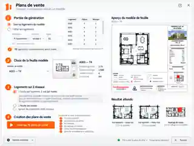
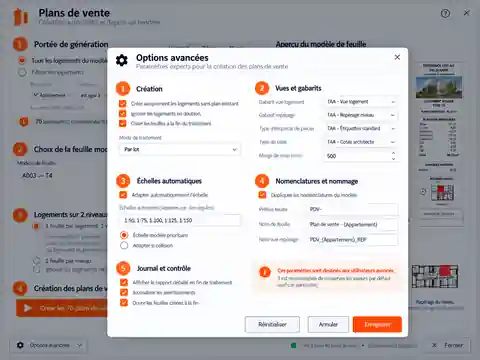

# Plans de vente — Références d'interface

Ces maquettes sont les références visuelles approuvées pour l'**Étape 09 —
stabilisation de l'interface V1** du module Plans de vente.

## Interface principale

Référence fonctionnelle :

- génération de tous les logements en une seule opération ;
- filtrage optionnel par paramètre de pièce, condition et valeur ;
- choix d'une feuille modèle ;
- choix du comportement pour les logements multi-niveaux ;
- un bouton principal de création par lot ;
- résumé du modèle et du résultat attendu.

## Options avancées

Référence fonctionnelle :

- création uniquement des logements sans plan existant ;
- choix du paramètre identifiant le logement ;
- marge de crop ;
- règle d'échelle automatique et échelles de repli ;
- paramètres de rapport et de contrôle ;
- les réglages déduits automatiquement de la feuille modèle restent en lecture
  seule tant qu'un remplacement manuel sûr n'est pas pris en charge.

## Charte graphique

L'implémentation doit réutiliser la charte commune Outils TAA :

- couleur de mise en avant Tallandier : `#FA641F`
  (`TAABrandOrangeBrush`) ;
- fond principal : `#F7F7F7` ;
- panneaux : blanc ;
- texte principal : `#252525` ;
- typographie : **Segoe UI** ;
- tailles, espacements et styles de contrôles issus des ResourceDictionary TAA.

Les maquettes servent de **référence d'intention**. Les contrôles WPF peuvent
être adaptés légèrement aux contraintes de pyRevit / Revit 2025.4, mais la
hiérarchie, les couleurs et le parcours utilisateur doivent rester cohérents
avec ces références.

## État de l'implémentation

### Étape 09A

Implémenté :

- nouvelle interface principale ;
- fenêtre Options avancées ;
- filtrage générique des logements ;
- génération par lot des logements mono-niveau ;
- saut automatique des plans déjà existants ;
- rapport de traitement.

### Étape 09B

À réaliser :

- génération correcte des logements comportant plusieurs niveaux ;
- une feuille avec une vue par niveau ;
- option « une feuille par niveau » ;
- repérage multi-niveaux adapté.

Le build 09A ne génère volontairement pas de plan multi-niveau incomplet.
